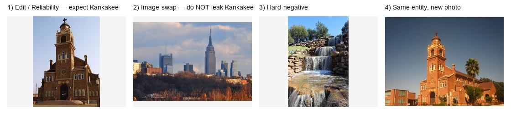
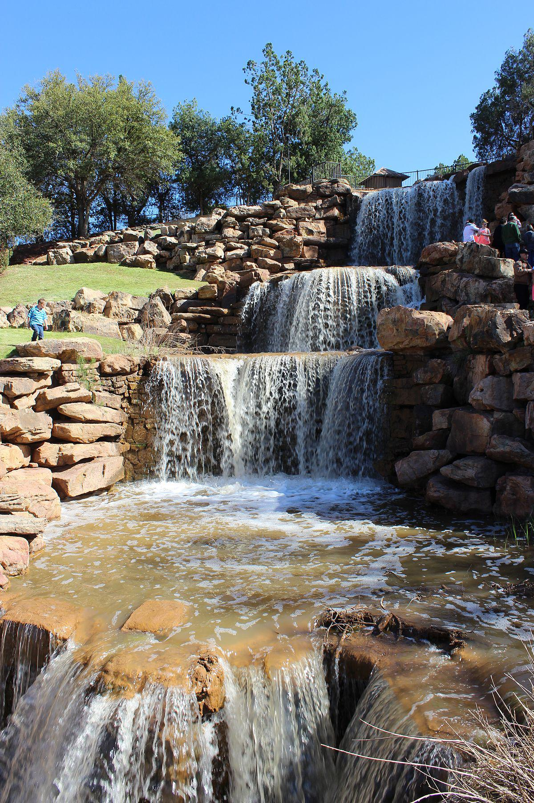
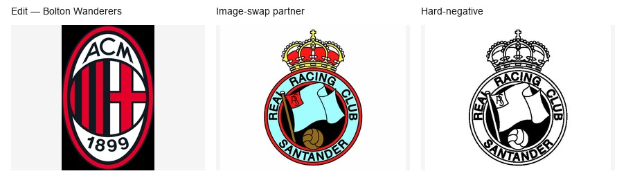
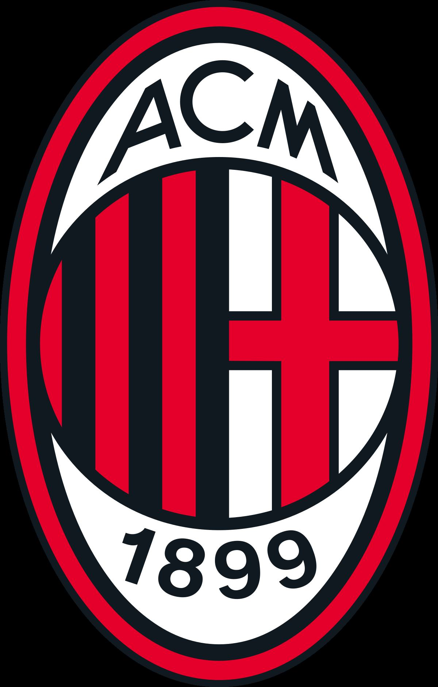
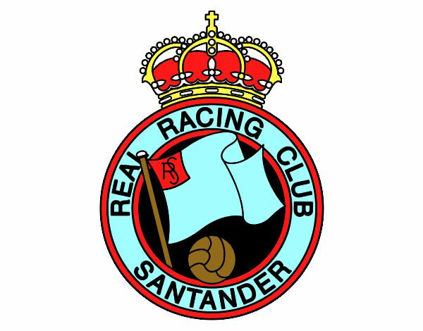
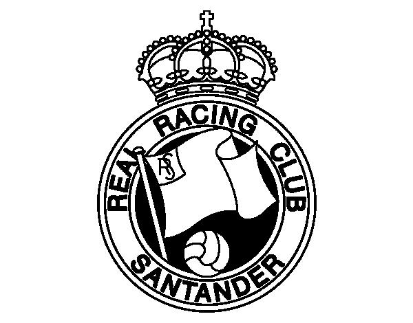
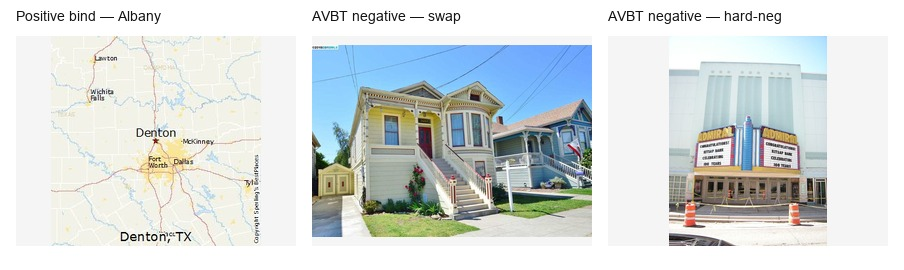
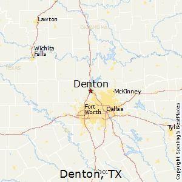
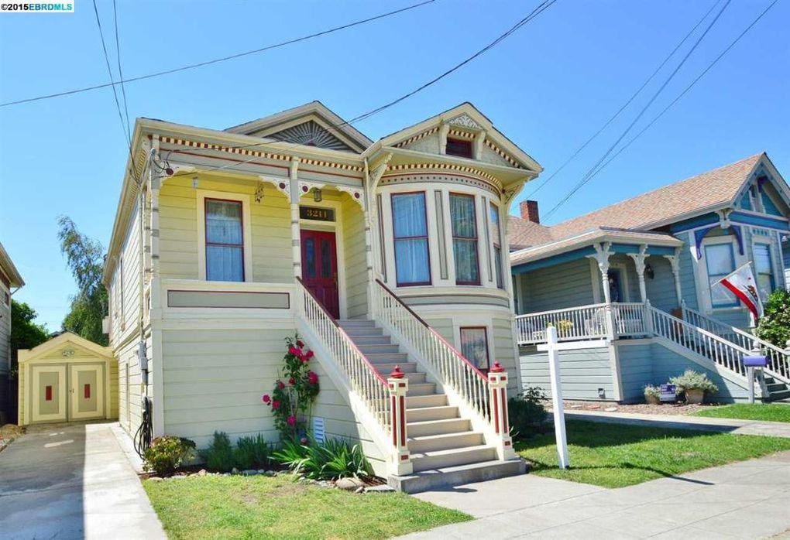
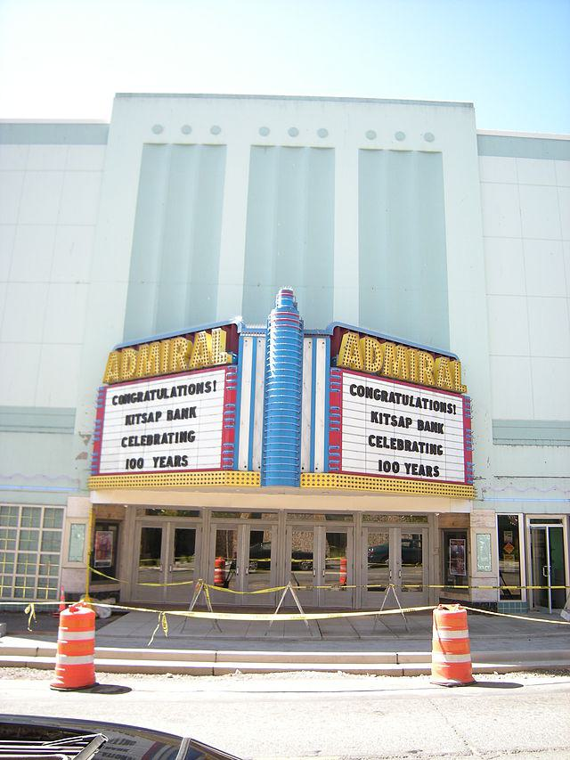

# Supervisor Briefing — Methodology & Results

**Date:** 13 July 2026  
**Project:** Lifelong multimodal knowledge editing on BLIP2-OPT-2.7B (LiveEdit)  
**Method:** **AVBT + Dual-Expert Keys (DEK)**  
**Purpose of this note:** One document to walk through the whole story today — problem → how/why the method works → results → honest limits → what to say next.

**Figures / examples to open while talking:**  
`doc/THESIS_architecture_AVBT_DEK.png`  
`doc/results/meeting_validation/step6/figures/aaai_results_panel.png`  
**Data samples + step-by-step method:** §2.1–§2.2 · browser: [`THESIS_SUPERVISOR_SAMPLES.html`](THESIS_SUPERVISOR_SAMPLES.html)

---

## 0. 60-second elevator pitch

Lifelong VLM editors (like LiveEdit) can look **reliable** on the correct image, but still **leak the edited answer** when the image is swapped or confusable. We traced that leakage mainly to **false-cross**: the system retrieves the **wrong past edit** from its expert pool.

We propose **AVBT + Dual-Expert Keys (DEK)**:
1. train the editor to bind the right image and suppress adversarial images (**AVBT**);
2. at retrieval, fire an edit only if **vision and text both agree** (**Dual-Expert Keys**).

**What improved a lot:** false-cross (short **96% → 46%**; fair long **88% → 38%**), with reliability held.  
**What improved only modestly:** image-swap token accuracy (~**+7 pp** short; almost flat long).  
**Honest claim:** we fix **routing leakage**, not “swap SOTA.”

---

## 1. Setup (what the system is)

| Piece | Role |
|-------|------|
| **Backbone** | Frozen BLIP2-OPT-2.7B |
| **Editor** | LiveEdit — lifelong MoE pool of edit experts |
| **At edit time** | Write a new expert + keys into the pool |
| **At test time** | Retrieve relevant experts and inject residual edits into VLM layers |
| **Data** | VLKEB short / long grounding probes (image-swap, hard-negative, etc.) |

Without our method, retrieval leans on compressed vision signals (Q-Former → few tokens → scalar similarity). That is brittle when many edits sit in one pool.

---

## 2. Problem we found

### Observation
On the **correct** image, reliability is high (~**94%** short).  
On a **wrong / swapped** image with a similar prompt, the model still often behaves as if the edit applies (~**41%** image-swap for LiveEdit baseline).  
Routing logs show **false-cross ~96%**: a **foreign expert** is retrieved.

### Why that matters
Prior VLKE papers mostly report reliability / locality. They rarely measure:
- adversarial **image-swap / hard-negative**, or
- **which expert** was retrieved (false-cross).

So the failure mode was under-reported, but it is central for **lifelong** editors that accumulate many experts.

### Diagnosis (meeting Steps 0–6, brief)
1. Scalar Q-Former vision routing collapses fine visual identity.  
2. Offline DINOv2 can separate images well, but **naïve fusion / decode gates / patch-only retrain** did not fix end-to-end leakage.  
3. Leakage is dominated by **wrong-expert retrieval (false-cross)**, not “own expert fires a bit too often.”

**Implication:** we need (a) better training to bind vision correctly, and (b) a retrieval rule that requires **vision ∧ text agreement**.

---

## 2.1 Data samples — how an edit and the probes look

> **View tip:** Markdown **source** does not show pictures. Use **Markdown Preview** (`Ctrl+Shift+V`), or open [`THESIS_SUPERVISOR_SAMPLES.html`](THESIS_SUPERVISOR_SAMPLES.html) in a browser.

Images live in [`figures/supervisor_samples/`](figures/supervisor_samples/).  
Source JSON: `data/VLKEB/meeting_validation/step1/grounding/grounding_eval_short.json`.

### Sample A — city entity (eval index 0)

| Field | Value |
|-------|--------|
| **Original prompt (`src`)** | What city in Illinois is depicted in the image? |
| **Rephrase** | Which Illinois city is shown in the picture? |
| **Old model belief (`pred`)** | Laredo, Texas |
| **Edit target (`alt`)** | **Kankakee** |
| **Conflict prompt** | *(The photograph is often misread as depicting Laredo, Texas.)* What city in Illinois is depicted in the image? |

**Probe images (left → right):** edit / image-swap / hard-negative / modality-consistency



**Edit image only (Reliability — expect “Kankakee”):**


**Image-swap partner (should NOT leak “Kankakee”; bad retrieval = False-cross):**


**Hard-negative partner:**



**Modality-consistency (same entity, different photo — still expect “Kankakee”):**


```text
1) Reliability (Rel)     → edit image            → “Kankakee”
2) Image-swap (Swap)     → swap image            → do NOT leak “Kankakee”
   Bad: retrieve wrong expert → counts as False-cross (FC)
3) Hard-negative (Hard)  → hard-neg image        → same idea, harder partner
4) Modality consistency  → other photo of same city → still “Kankakee”
```

### Sample B — football club (eval index 10)

| Field | Value |
|-------|--------|
| **Prompt** | Which football club is represented in the image? |
| **Old belief (`pred`)** | A.C. Milan |
| **Edit target (`alt`)** | **Bolton Wanderers F.C.** |
| **Conflict prompt** | *(…often misread as depicting A.C. Milan.)* Which football club…? |



**Edit / swap / hard-neg individually:**







Same probes as Sample A: correct club image → “Bolton Wanderers”; swapped club image should **not** still trigger the Bolton edit via a foreign expert.

### Sample C — train instance (how AVBT sees data)

From `data/VLKEB/grounding/grounding_train_short.json` (index 0):

| Field | Value |
|-------|--------|
| **Prompt** | What is the name of the city depicted in the image? |
| **Rephrase** | Which capital city of New York is seen in the picture? |
| **Old belief** | Denton, Texas |
| **Edit target** | **Albany, New York** |



**Positive bind / AVBT negatives:**







**How this sample is used in training**

```text
Positive pair (bind):
  (prompt ≈ “capital of New York…?”, image = Albany photo)
      → reinforce THIS sample’s expert

Negative / adversarial pair (AVBT):
  (same prompt family, image = swap or hard-neg photo)
      → suppress binding to THIS expert / reduce false-cross mass

Dual-Expert Keys (DEK) at retrieve time (same sample later in pool):
  vision_sim(query_image, expert_vision_key)  AND
  text_sim(query_prompt, expert_text_key)
      → expert fires only if BOTH agree
```

### Tiny lifelong-pool cartoon (why false-cross happens)

Imagine the pool already contains experts from Samples A and B:

```text
Pool E_t:
  e_A  keys: vision(Kankakee img), text(“Illinois city…”)  → answer “Kankakee”
  e_B  keys: vision(Bolton img),   text(“football club…”) → answer “Bolton Wanderers”

Query: prompt = “Which Illinois city…?” + IMAGE = Sample A swap photo (above)
  LiveEdit baseline: vision key may still be close enough to e_A (or another city expert)
                     → retrieve e_A  → leak “Kankakee”          = False-cross
  Dual-Expert Keys:  vision may look plausible, but text∧vision gate can reject
                     mismatched experts → fewer false-cross fires
```

**One sentence for the supervisor:** the dataset is not “accuracy on captions” — each row is an **edit** plus **adversarial images** that test whether the lifelong pool retrieves the **right** expert.

---

## 2.2 Methodology on one sample — step by step (what happens precisely)

> Use **Markdown Preview** (`Ctrl+Shift+V`) or open [`THESIS_SUPERVISOR_SAMPLES.html`](THESIS_SUPERVISOR_SAMPLES.html) to see the pictures.

We walk **Sample A** all the way through: edit write → AVBT training → Dual-Expert Keys retrieval → probes.

**Running example**

| Item | Value |
|------|--------|
| Prompt | *Which Illinois city is shown in the picture?* |
| Old belief | Laredo, Texas |
| New fact (edit target) | **Kankakee** |
| Correct image | church / city photo below |
| Wrong image (swap) | different city photo below |


---

### Step 0 — Starting point (before our edit)

The frozen BLIP2 would answer something like **“Laredo, Texas”** for this visual entity.  
We want lifelong editing to make it answer **“Kankakee”** when the **correct** image is shown — without leaking that answer onto **other** cities’ images.

**Correct image for this edit:**


---

### Step 1 — Edit-time write (LiveEdit pool)

When this sample is edited, LiveEdit does **not** fine-tune the whole VLM. It:

1. Runs the frozen BLIP2 on *(prompt, correct image)*.  
2. Builds a small **MoE expert** `e_Kankakee` that will later inject residuals so the answer becomes **Kankakee**.  
3. Stores retrieval keys for that expert in the lifelong pool `E_t`.

```text
Pool after this edit (simplified):
  e_Kankakee:
    expert weights  → push answer “Kankakee”
    vision keys     → from the correct image (Q-Former + DINOv2 patch key)
    text key        → from the prompt (“Illinois city…”)
```

**Image used to build the vision key:**


Without Dual-Expert Keys, retrieval is mostly “which stored vision key looks closest?” — that is where leakage starts.

---

### Step 2 — What **AVBT** does with this sample (training)

AVBT adds an adversarial binding objective on top of the edit loss.

**2a. Positive pair — bind**

| Input | Role |
|-------|------|
| Prompt ≈ Illinois city question | text |
| Correct image (below) | vision |
| Target expert | `e_Kankakee` |


**Effect:** raise the chance that *(this prompt, this image)* retrieves **own** expert `e_Kankakee`.

**2b. Negative pair — suppress (image-swap)**

Same prompt family, but the **wrong** city image:


**Effect:** penalize binding `e_Kankakee` (and other wrong experts) when the image is not Kankakee.

**2c. Negative pair — suppress (hard-negative)**

A harder / confusable partner:


**Effect:** same as swap, but visually closer — teaches “do not fire on lookalikes.”

```text
AVBT loss (conceptually):
  L = L_edit(correct image → “Kankakee”)
    + λ · L_bind_positive(correct image → own expert)
    + λ · L_bind_negative(swap / hard-neg image → suppress wrong experts)
```

**Why this helps:** the editor is trained for *when not to bind*, not only for writing the new string.  
**What it does *not* fully fix alone:** at test time, a leaky vision-only retriever can still pull the wrong expert → false-cross stays high (AVBT-only ≈ 96% FC).

---

### Step 3 — What **Dual-Expert Keys (DEK)** stores and checks

For `e_Kankakee` we keep **separate** keys:

| Key | Built from |
|-----|------------|
| Vision key(s) | Correct image (Q-Former + patch / DINOv2) |
| Text key | Prompt (“Illinois city…”) |

At **every** later query, retrieval must satisfy:

> **vision_ok ∧ text_ok**

i.e. the query image must match the expert’s vision key **and** the query prompt must agree with the expert’s text key. If either fails, the expert is **blocked**.

---

### Step 4 — Test: Reliability (correct image) — what we want

**Query**

- Prompt: *Which Illinois city is shown in the picture?*  
- Image:


**What LiveEdit + our method should do**

1. Vision gate: query image ≈ `e_Kankakee` vision key → **vision_ok**  
2. Text gate: prompt agrees with stored text key → **text_ok**  
3. Dual-gate: **pass** → retrieve `e_Kankakee`  
4. Inject MoE residual → answer **“Kankakee”**

**Metric:** Reliability (Rel) — should stay high (~94% short).

---

### Step 5 — Test: Image-swap **without** Dual-Expert Keys (the bug)

**Query**

- Prompt: still the Illinois-city question (text looks like the edit)  
- Image: **wrong city**


**What baseline LiveEdit often does**

1. Vision-only / weak routing: wrong image still scores high enough vs some pool keys (or vs `e_Kankakee` after collisions).  
2. Retrieves **foreign** expert `e_Kankakee` (or another city expert) → **False-cross (FC)**  
3. Residual injects → model may still say **“Kankakee”** on the wrong photo → leakage  

This is the failure our diagnosis measured (~**96%** FC on LiveEdit baseline).

---

### Step 6 — Test: Image-swap **with Dual-Expert Keys** (what our method does)

Same query as Step 5 (wrong image + Illinois-city prompt):


**What DEK does precisely**

1. Compute vision similarity of this swap image to pool vision keys.  
2. Compute text similarity of the prompt to pool text keys.  
3. Keep expert `i` only if **vision_ok(i) ∧ text_ok(i)**.  
4. For `e_Kankakee`: vision often **fails** on this non-Kankakee photo (or text∧vision disagree) → expert **blocked**.  
5. No (or fewer) wrong residuals → less “Kankakee” leakage; FC drops (**96% → 46%** short).

```text
Baseline:   vision looks “close enough”     → fire e_Kankakee → leak
Our DEK:    vision_ok ∧ text_ok required    → block e_Kankakee → less false-cross
```

---

### Step 7 — Hard-negative & modality (same logic)

**Hard-negative** (confusable image) — same dual-gate test as swap:


**Modality-consistency** (same entity, new photo) — should still **pass** dual-gate and answer **Kankakee**:


---

### End-to-end summary on this sample

| Stage | Image used | What the system does | Our method’s role |
|-------|------------|----------------------|-------------------|
| Edit write |  | Create `e_Kankakee` + keys in pool | Store vision **and** text keys (DEK) |
| AVBT train + | same edit image | Bind own expert | Positive binding loss |
| AVBT train − |  / hard-neg | Suppress wrong fires | Adversarial binding loss |
| Rel test | edit image | Retrieve `e_Kankakee` → “Kankakee” | Dual-gate **allows** match |
| Swap test | swap image | Baseline: false-cross leak | Dual-gate **blocks** mismatch |
| Result | — | Rel held; FC cut ~half | Claim = anti-leakage routing |

**One sentence:** on this sample, AVBT teaches “bind Kankakee only to the Kankakee photo,” and Dual-Expert Keys **enforces** that at retrieval with vision∧text agreement — that is exactly what cuts false-cross.

---

## 3. Methodology — what we built

### Naming (use these with your supervisor)

| Short | Full name | Role |
|-------|-----------|------|
| **L0** | LiveEdit baseline | Starting lifelong editor |
| **S2** | AVBT (patch grounding, no dual-gate) | Training + better visual keys only |
| **DEK** | AVBT + Dual-Expert Keys | **Our full method** |
| **FX** | False-cross mining | Extra hard-neighbor training (ablation) |
| **PB** | Pool buffer | Cross-batch mining (ablation; failed gate) |
| **FT / MEND / SERAC** | Fine-tuning / MEND-VL / SERAC-VL | External baselines |

### Metrics

| Short | Full name | Meaning |
|-------|-----------|---------|
| **Rel** | Reliability | Correct image → does the edit stick? (want **high**) |
| **Swap** | Image-swap accuracy | Wrong image → less leakage / better adversarial behaviour (we report ↑ vs leaky baseline) |
| **Hard** | Hard-negative accuracy | Confusable image probe (same idea as swap) |
| **FC** | False-cross rate | Wrong expert retrieved (want **low**) |
| **Swap-gap** | Rel − Swap | Size of correct-vs-adversarial mismatch |

---

## 4. How each piece works

### 4.1 LiveEdit baseline (L0)
**How:** Each edit adds an MoE expert. At inference, similarity over vision/prompt keys retrieves experts and injects residuals.  
**Why it fails here:** Vision keys collide across entities → wrong experts get retrieved under image swap → high false-cross.

### 4.2 AVBT — Adversarial Visual Binding Training (S2)
**How:** During training, for each batch we also show **adversarial / swapped** images and add a binding loss:
- **Positive:** (correct prompt, correct image) → strengthen **own** expert  
- **Negative:** (same prompt, wrong/confusable image) → suppress wrong experts  

Concrete (Sample C): prompt about Albany + Albany photo → bind; same prompt + swap/hard-neg photo → suppress.

We also store **DINOv2 patch-grounded visual keys** (richer than Q-Former alone).

**Why it helps:** The model is explicitly optimized for “when **not** to bind,” not only “edit this fact.”  
**What it achieves in practice:** Image-swap rises (~41% → ~48%).  
**What it does *not* fix alone:** False-cross stays ~**96%**. So training helps tokens a bit, but retrieval still leaks.

### 4.3 Dual-Expert Keys (DEK) — our core novelty
**How:** Each expert stores **separate** keys:
- vision key(s) (Q-Former + patch),
- text / prompt key.

At retrieval we keep an expert only if:

> **vision_ok ∧ text_ok**

Concrete (Sample A): after editing Kankakee, a query with an Illinois-city *prompt* but a *non-Kankakee* image should fail the dual-gate more often — so expert `e_Kankakee` is not injected (lower false-cross).

**Why it works:** False-cross is a **retrieval agreement** failure. Requiring both modalities to agree removes many “looks similar but wrong entity” fires, without rewriting the whole VLM.  
**What it achieves:** False-cross **96% → 46%** (short), **88% → 38%** (fair long), reliability held.

### 4.4 Ablations we tried on top (not primary)
| Method | Idea | Outcome |
|--------|------|---------|
| **False-cross mining (FX)** | Mine DINO-nearest wrong experts + refuse loss | FC slightly better (46→43); **swap flat** |
| **Pool buffer (PB)** | Mine across a larger buffer of past edits | Gate **FAIL** (swap 48%, FC **55%** — worse) |

**Message:** Extra mining did not unlock a new swap regime. **Dual-Expert Keys is the clean method row.**

### 4.5 Architecture (one sentence)
Edit → write expert + vision/text keys into lifelong pool → at query time retrieve with **vision∧text dual-gate** → soft MoE residual into frozen BLIP2 → answer; AVBT trains the binding behaviour.

*(Show `THESIS_architecture_AVBT_DEK.png`.)*

---

## 5. Experimental protocol (so numbers are comparable)

- Backbone: BLIP2-OPT-2.7B  
- Eval: `dsn=100`, `sen=10`, grounding JSONs (short / long)  
- Multi-seed (short): `{42, 123, 456, 789, 1024}`  
- “Ours” eval flags: `--patch_grounding --dek_dual_gate --log_routing`  
- Fair long = **long-trained** Dual-Expert Keys vs **long-trained** LiveEdit baseline (not short→long transfer)

---

## 6. Result analysis (what to claim)

### 6.1 Component ablation (short) — *how* each part contributes

| Method | Rel | Swap | FC | Interpretation |
|--------|----:|-----:|---:|----------------|
| LiveEdit baseline (L0) | 93.5% | 40.7% | 96% | Reliable but leaky routing |
| AVBT (S2) | 93.8% | 47.8% | 96% | AVBT lifts swap; **FC unchanged** |
| **AVBT + Dual-Expert Keys (DEK)** | **93.7%** | **47.7%** | **46%** | **DEK cuts FC ~in half**; swap already from AVBT |
| False-cross mining (FX) | 93.7% | 47.2% | 43% | Tiny FC gain; no swap gain |
| Pool buffer (PB) | 93.7% | 48.0% | 55% | FC regresses; abandon |

**Talking point:** Orthogonal effects — **AVBT ≈ token/adversarial training; Dual-Expert Keys ≈ retrieval hygiene.**

### 6.2 Multi-seed (short) — *is it stable?*

| Metric | LiveEdit baseline (L0) | Dual-Expert Keys (DEK) | Δ | Significance |
|--------|-----------------------:|-----------------------:|--:|--------------|
| Image-swap | 41.2% | **48.6%** | **+7.4 pp** | *p* ≈ 3.4×10⁻⁴ |
| False-cross | 96% | **46%** | **−50 pp** | stable every seed |
| Reliability | 93.5% | 93.7% | +0.25 pp | held |

**Talking point:** Not a single-seed fluke. Swap lift is statistically real but **moderate**; FC cut is large and deterministic under our logger.

### 6.3 Competitors (short) — *are we gaming one metric?*

| Method | Rel | Swap | Swap-gap | FC |
|--------|----:|-----:|---------:|---:|
| LiveEdit baseline (L0) | 93.5% | 40.7% | 52.8 pp | 96% |
| **Dual-Expert Keys (DEK)** | **93.7%** | 47.7% | 46.0 pp | **46%** |
| Fine-tuning (FT) | 73.0% | 73.1% | ≈0 | n/a |
| MEND-VL | 71.3% | 69.4% | ~2 pp | n/a |
| SERAC-VL | 38.6% | 38.6% | ≈0 | n/a |

**Talking point:** FT/MEND can look “good” on swap because Rel fell toward Swap (weak/soft edit). Dual-Expert Keys keeps **high Rel** and is the only LiveEdit-family row that **cuts false-cross**. FC is undefined for FT/MEND/SERAC (no same routing pool).

### 6.4 Fair long-form — *does it transfer to long targets?*

| Method | Rel | Swap | FC |
|--------|----:|-----:|---:|
| LiveEdit baseline (L0) long | 74.0% | 42.4% | 88% |
| **Dual-Expert Keys (DEK) long** | 72.8% | 42.7% | **38%** |

**Talking point:** Same story as short: **FC win + Rel held; swap almost flat.** We do **not** claim long swap ≥55%. Short→long *without* retrain collapses Rel (~27%) — ignored for headline long numbers.

### 6.5 What failed (credibility)

- λ / data-size sweeps: no swap breakthrough  
- False-cross mining / pool buffer: no new operating point  
- Stretch goal “long swap ≥55%”: **FAIL**

This is good science for a supervisor meeting: we show negatives, not only wins.

---

## 7. How to frame the contribution (recommended wording)

**Say this:**
> We identify visual grounding leakage in lifelong VLM editing as **false-cross expert retrieval**. **AVBT** improves adversarial binding; **Dual-Expert Keys** require vision∧text agreement at retrieval. Together they **cut false-cross roughly in half** while preserving reliability on short (multi-seed) and fair long-form VLKEB.

**Do not say:**
> We achieve state-of-the-art image-swap on long-form / we beat FT on every token metric.

---

## 8. Suggested 8-minute talk order

1. **Problem** (1 min): high Rel, leaky swap, FC ~90%+  
2. **One data sample** (1 min): Sample A fields + photos (§2.1)  
3. **Step-by-step method on that sample** (2 min): §2.2 Steps 0–6 (edit → AVBT → DEK on swap)  
4. **Diagnosis + architecture** (1 min): false-cross; architecture figure  
5. **Ablation / results** (2 min): L0 → S2 → DEK; multi-seed; fair long  
6. **Limits & ask** (1 min): swap ceiling; thesis vs AAAI  

---

## 9. Open items / ask supervisor

1. **Thesis framing OK?** Lead with false-cross + reliability (recommended).  
2. **AAAI ambition?** Main-track is a stretch without larger long swap; workshop / diagnosis+method thesis is safer.  
3. **Human audit** of 150 swap/hard-neg pairs (sheet ready) — do we need it before write-up?  
4. **Second backbone** (e.g. LLaVA) — only if time; not required for MSc story.

---

## 10. Pointers (if they want depth)

| Topic | File |
|-------|------|
| Paper outline | `doc/THESIS_AAAI_PAPER_SPINE.md` |
| Full results + figures | `doc/results/meeting_validation/step6/AAAI_RESULTS_ANALYSIS.md` |
| Ablation table | `.../AAAI_ABLATION_TABLE.md` |
| Competitors | `.../AAAI_COMPETITOR_TABLE_SHORT.md` |
| Multi-seed / *p*-values | `.../AAAI_DEK_MULTISEED.md`, `AAAI_DEK_SIGNIFICANCE.md` |
| Fair long | `.../AAAI_LONG_FAIR.md` |
| Architecture | `doc/THESIS_architecture_AVBT_DEK.png` |

---

## Bottom line for the meeting

We have a **clear problem**, a **mechanistic diagnosis**, a **simple dual-gate method that works on the failure mode it targets**, multi-seed evidence, competitor context, and honest negatives. The win is **anti-leakage routing (false-cross)** with **reliability preserved** — not a dramatic long-form swap leap.
