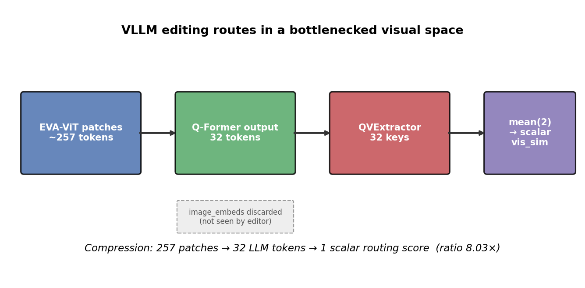
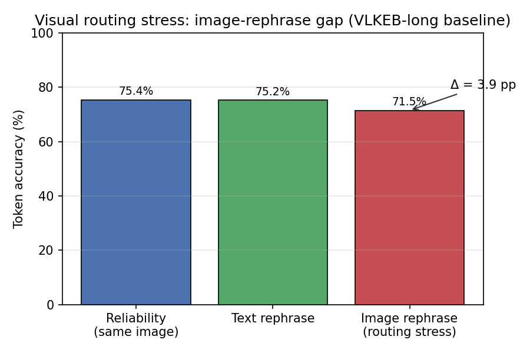
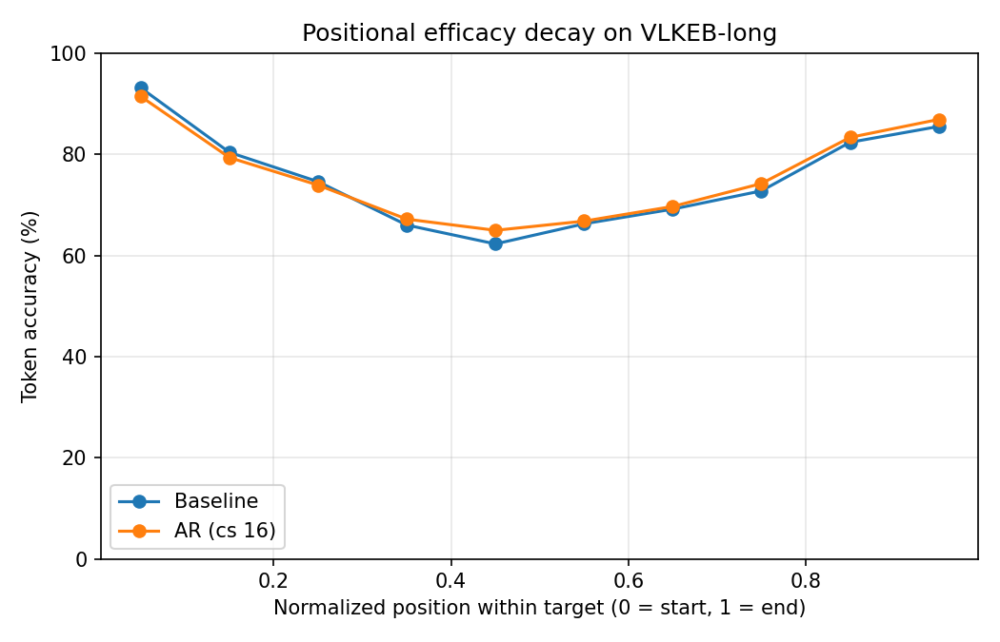

# VLLM Knowledge Editing Challenge Memo (Step 0)

**Thesis framing:** Lifelong vision–language model (VLLM) editing fails when **routing** must discriminate **visually similar** edits, but the editor only sees a **compressed visual key** collapsed to a near-scalar score. This memo documents the bottleneck on existing LiveEdit checkpoints and baseline failure modes before any new patch-grounding layer.

**Scope:** Diagnosis only — no retraining. Complements [THESIS_POSITIONAL_DECAY.md](THESIS_POSITIONAL_DECAY.md) (long-form secondary symptom).

---

## 1. Core challenge

Knowledge editing in VLMs is not only “inject the right delta at the right layer.” At inference, LiveEdit must **retrieve** the correct mixture-of-experts (MoE) entry from a growing pool using **visual + textual similarity**. When many edits share similar prompts or visually confusable images, routing errors propagate directly into wrong edits — even if each individual expert was trained well.

**Unifying hypothesis:** LiveEdit routes on **32 Q-Former tokens** that are further compressed to a **scalar** routing score (`vis_sim.mean(2)`). Fine-grained spatial evidence from the ViT patch grid never reaches the editor. Lifelong VLLM editing therefore breaks on probes that require **image-conditioned** discrimination (image rephrase, hard visual negatives, counterfactual swaps).

---

## 2. Where the bottleneck lives (code)

### 2.1 Q-Former discards patch grid

In BLIP2, ~**257** EVA-ViT patch embeddings are cross-attended by the Q-Former; only **32** query tokens are projected into the LLM. Raw `image_embeds` are not forwarded:

```190:212:editor/vllms_for_edit/blip2/blip2.py
            vision_outputs = self.model.vision_model(
                pixel_values=pixel_values,
                ...
            )
            image_embeds = vision_outputs[0]
            ...
            query_outputs = self.model.qformer(
                query_embeds=query_tokens,
                encoder_hidden_states=image_embeds,
                ...
            )
            query_output = query_outputs[0]
            ...
            language_model_inputs = proj(query_output.to(dtype=qdtype))
```

**Impact:** The editor’s vision stream is already a **global summary** before LiveEdit sees it.

### 2.2 Routing key collapse (mean-pool)

LiveEdit extracts `eqe_n` cross-attention routing keys per pool entry, then **mean-pools** them into one scalar per expert:

```172:176:editor/vllm_editors/liveedit/liveedit.py
        ivr = self.inpt_extractor.extract_vision(query_reps, vision_reps)
        vis_sim = torch.einsum('bed,med->bme', ivr, self.evr_pool_gated).mean(2) * self.sim_scale
        ...
        retrieval_map_gated = (vis_sim > vis_sim_prot).to(torch.bool)[0]
```

**Impact:** Spatial structure within the 32-token routing key is discarded. Visually similar images map to nearby scalars → **false expert activation** on `image_rephrase` and hard-negative probes.

### 2.3 Static compression accounting

| Stage | Tokens / dimensionality | Reaches editor? |
|-------|-------------------------|-----------------|
| EVA-ViT patches | ~257 | No (dropped after Q-Former) |
| Q-Former → LLM | 32 | Yes (vision token span) |
| QVExtractor routing keys | 32 (`eqe_n`) | Yes |
| `vis_sim` per pool entry | **1 scalar** (mean-pooled) | Used for hard routing |

**Compression ratio:** ~257 patches → 1 scalar ≈ **8×** from Q-Former alone, **257×** from patches to routing score.



*Figure 1. Visual information flow in BLIP2 + LiveEdit: patch grid → 32 LLM tokens → mean-pooled scalar routing key.*

---

## 3. Baseline failure modes (existing checkpoints)

Evidence from **VLKEB-long** eval (seed 42, 3150 sequential edits, long-trained baseline checkpoint) without any new training:

| Symptom | Metric | Baseline value | Interpretation |
|---------|--------|----------------|--------------|
| **Image-generality gap** | Image rephrase acc | **71.5%** | Largest generality drop vs same-image reliability (75.4%) |
| **Text vs image rephrase** | Text 75.2% vs image 71.5% | **−3.7 pp** | Failure concentrates on **visual** probes, not paraphrase |
| **Reliability–image gap** | Δ (reliability − image rephrase) | **−4.0 pp** | Edit survives prompt change better than image change |
| **Locality (output)** | Image locality acc | 100% | Logit unchanged on unrelated images — routing may still **fire** silently |
| **Positional trough** | Decile 4 token acc | **62.3%** | Long-answer mid-sequence weakness (secondary; see positional decay doc) |



*Figure 2. Token accuracy on reliability vs generality probes. The image-rephrase gap is consistent with routing in a visually compressed space (same checkpoint, no retrain).*



*Figure 3. U-shaped positional efficacy (secondary symptom). Mid-answer tokens are hardest; AR partially lifts the trough but does not fix visual routing. Source: [THESIS_POSITIONAL_DECAY.md](THESIS_POSITIONAL_DECAY.md).*

### 3.1 Expected routing failure signatures (Step 1 probes)

When `tools/log_routing_diagnostics.py` is run on the baseline checkpoint, we expect:

1. **False cross-edit activation** on `image_rephrase` — wrong pool index fires when the image changes but the prompt stays fixed.
2. **Miss** on `image_rephrase` — correct expert not retrieved despite successful reliability on the original image.
3. **Locality false fire** — experts retrieved on `image_loc` probes (orthogonal image + question); output may still match pre-edit due to low fusion weight, but routing is not visually grounded.

---

## 4. Routing diagnostic protocol

### 4.1 Log `retrieve_moes` on 100–200 samples

```powershell
# Baseline long-form checkpoint (replace with your path)
conda run -n liveedit python tools/log_routing_diagnostics.py `
  -ckpt "records/liveedit/blip2-opt-2.7b/VLKEB_long_baseline-.../checkpoints/epoch-20-....pt" `
  -dvc cuda:0 -dsn 150 -seed 42 `
  -dpath data/VLKEB_long/eval_longform.json `
  -out doc/results/routing_diagnostics_baseline.json

# Optional: AR checkpoint
conda run -n liveedit python tools/log_routing_diagnostics.py `
  -ckpt "records/liveedit/blip2-opt-2.7b/VLKEB_long_ar-.../checkpoints/epoch-20-....pt" `
  -dvc cuda:0 -dsn 150 -seed 42 --ar_mode --chunk_size 16 `
  -out doc/results/routing_diagnostics_ar.json
```

Each JSON record includes per-probe: `vis_sim`, `vis_sim_prot`, `retrieved_indices`, `false_cross_edit`, `miss`, `false_fire`, and `ivr_eqe_std` (routing-key variance before mean-pool).

### 4.2 Plot routing failure rates

```powershell
conda run -n liveedit python tools/plot_routing_diagnostics.py `
  --routing-json doc/results/routing_diagnostics_baseline.json
```

Outputs: `results_routing_probe_rates.png`, `results_routing_sim_margin.png`.

### 4.3 Architecture-only (no GPU)

```powershell
conda run -n liveedit python tools/log_routing_diagnostics.py --architecture-only
conda run -n liveedit python tools/plot_routing_diagnostics.py --architecture-only
```

---

## 5. Step 0 gate (proceed to Step 1?)

| Criterion | Status | Evidence |
|-----------|--------|----------|
| Visual bottleneck documented | **Pass** | Fig 1; §2 code paths |
| Image-probe degradation vs reliability | **Pass** | Fig 2; −4.0 pp image-rephrase gap |
| Long-form positional symptom catalogued | **Pass** | Fig 3; decile-4 trough 62.3% |
| Per-sample routing logs (150+ probes) | **Pass** | `doc/results/routing_diagnostics_baseline.json` (150 samples, 600 probes) |

**Decision:** **Proceed to Step 1 (adversarial / grounding tests).** Routing logs (seed 42, n=150, baseline ckpt) confirm **multi-expert co-retrieval** under lifelong pooling (~3.8 experts/query) and **image-rephrase discrimination failures** (6% miss, 4% only-wrong-expert). Locality routing remains clean (0% false fire on image_loc).

---

## 6. Code touchpoints added for Step 0

| File | Change |
|------|--------|
| `editor/vllm_editors/liveedit/liveedit.py` | `probe_routing()`; `retrieve_moes(..., return_retr_details=True)` returns `retrieved_indices` |
| `tools/log_routing_diagnostics.py` | Sequential edit + probe JSON dump |
| `tools/plot_routing_diagnostics.py` | Bottleneck diagram + routing rate plots |

---

## 7. One-paragraph summary (paste-ready)

VLLM knowledge editing with LiveEdit is fundamentally a **retrieval problem in a bottlenecked visual space**. BLIP2 compresses ~257 ViT patches to 32 Q-Former tokens before the LLM; LiveEdit then mean-pools 32 cross-attention routing keys into a **scalar** similarity score for hard MoE selection. On VLKEB-long (existing long-trained checkpoint, no retrain), **image rephrase** accuracy (71.5%) trails **reliability** (75.4%) by 4.0 pp — while text rephrase and locality outputs remain strong — indicating that failures concentrate on **visual discrimination**, not prompt memorisation alone. Long-form answers additionally show a **mid-sequence efficacy trough** (~62% at decile 4). Together, these motivate Step 1 adversarial grounding probes and, if confirmed, patch-level routing (Steps 4–5) rather than further text-only scaling.
