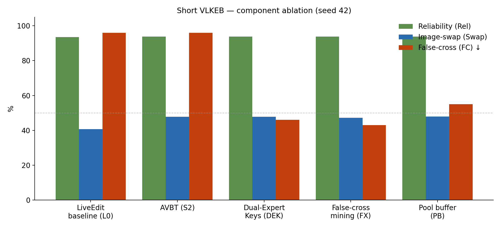
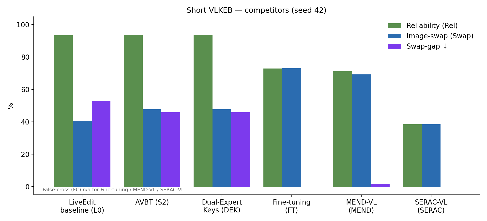
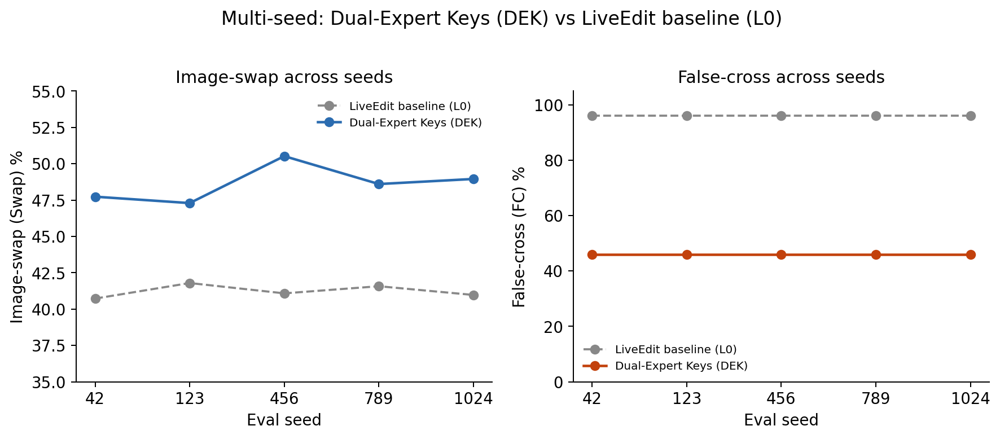
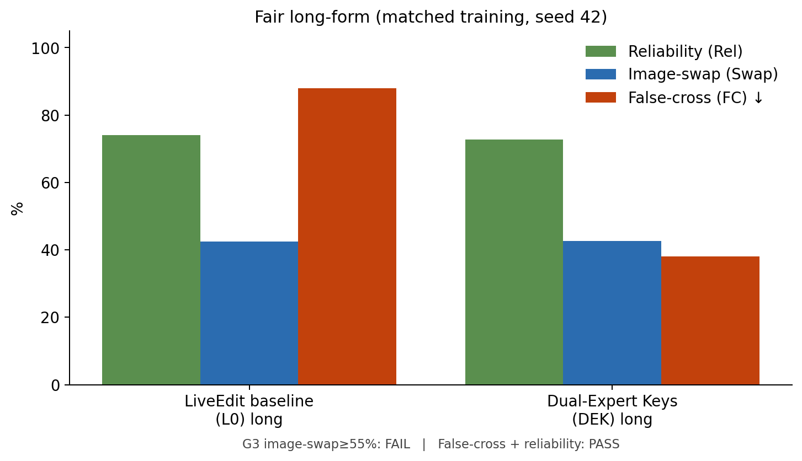

# AAAI / Thesis — Results Analysis (AVBT + Dual-Expert Keys)

**Date:** 2026-07-13  
**Protocol:** short/long grounding, `dsn=100`, `sen=10`, BLIP2-OPT-2.7B  
**Figures:** [`figures/`](figures/)  
**Sources:** `aaai_ablation_table.json` · `aaai_competitor_short.json` · `aaai_dek_multiseed.json` · `aaai_dek_significance.json` · `aaai_long_fair.json` · `aaai_standard_metrics_short.json`

---

## 0. Standard Rel/Gen/Loc (short main protocol) — LiveEdit-style

**Doc:** [`AAAI_STANDARD_METRICS_SHORT.md`](AAAI_STANDARD_METRICS_SHORT.md)  
Extracted from existing `aaai_*_short` grounding evals (no new GPU run).

| Method | Rel↑ | T-Gen↑ | M-Gen↑ | T-Loc↑ | M-Loc↑ | FC↓ |
|--------|-----:|-------:|-------:|-------:|-------:|----:|
| Lifelong baseline (L0) | 93.5% | 94.3% | 92.1% | 100% | 100% | 96% |
| AVBT only (S2) | 93.8% | 94.5% | 93.8% | 100% | 100% | 96% |
| **Dual-Expert Keys (DEK)** | **93.7%** | **94.5%** | **92.0%** | **100%** | **100%** | **46%** |

**Paper claim:** DEK preserves standard Rel/Gen/Loc; FC is the win.

---

## Naming legend

| Short | Full name |
|-------|-----------|
| **L0** | LiveEdit baseline |
| **S2** | Adversarial Visual Binding Training / AVBT (patch grounding, no dual-gate) |
| **DEK** | AVBT + Dual-Expert Keys (vision ∧ text gate) — **ours** |
| **FX** | AVBT+DEK + false-cross mining (neighbor + refuse) |
| **PB** | AVBT+DEK + pool buffer |
| **FT** | Fine-tuning (FT-VL) |
| **MEND** | MEND-VL |
| **SERAC** | SERAC-VL |
| **Rel** | Reliability (correct-image edit accuracy) |
| **Swap** | Image-swap accuracy |
| **Hard** | Hard-negative accuracy |
| **FC** | False-cross rate (wrong expert retrieved) ↓ |
| **Swap-gap** | Reliability − image-swap |

---

## 1. Headline takeaways

1. **Dual-Expert Keys (DEK) is the FC mechanism.** AVBT (S2) lifts image-swap but leaves false-cross at **96%**. Adding Dual-Expert Keys cuts FC to **46%** (short) / **38%** (fair long) with reliability held.
2. **Swap ceiling ~47–49% short.** False-cross mining (FX) / pool buffer (PB) do not clear a 50% gate; FX slightly better FC (43%) but no swap gain; PB **regresses** FC to 55%.
3. **Multi-seed (n=5):** Dual-Expert Keys (DEK) swap **+7.4 pp** vs LiveEdit baseline (L0) (*p*≈3.4×10⁻⁴); FC **−50 pp** (stable).
4. **Competitors:** Fine-tuning (FT) / MEND-VL / SERAC-VL show lower reliability and near-zero swap-gap (weak/soft edit). Dual-Expert Keys uniquely keeps ~94% rel while attacking routing leakage.
5. **Fair long:** FC story holds; G3 swap ≥55% **fails** (~43%).
6. **EVQA dataset stress (new):** EasyEdit EVQA + swap/hard-neg probes; Dual-Expert Keys cut FC (**pilot FC swap/hard 97%/92%→0%/0%; multi-seed dsn=300: FC swap 31%±38%→1.5%±1.1%, FC hard 97%±0.6%→2.7%±1.3%**, Rel held ~95%). AVBT alone tracks L0 on FC. Full tables: [`stress/AAAI_EVQA_STRESS_RESULTS.md`](stress/AAAI_EVQA_STRESS_RESULTS.md).

**Paper claim:** anti-leakage routing (FC + rel), not token-swap SOTA.

---

## 2. Figures

| Figure | File | What it shows |
|--------|------|----------------|
| Ablation | [`figures/aaai_ablation_short.png`](figures/aaai_ablation_short.png) | LiveEdit baseline (L0) → AVBT (S2) → Dual-Expert Keys (DEK) → FX → PB |
| Competitors | [`figures/aaai_competitors_short.png`](figures/aaai_competitors_short.png) | Baseline / Dual-Expert Keys vs Fine-tuning / MEND / SERAC |
| Multi-seed | [`figures/aaai_multiseed_dek.png`](figures/aaai_multiseed_dek.png) | Per-seed swap & FC, Dual-Expert Keys (DEK) vs LiveEdit baseline (L0) |
| Fair long | [`figures/aaai_long_fair.png`](figures/aaai_long_fair.png) | Matched long train+eval |
| Panel | [`figures/aaai_results_panel.png`](figures/aaai_results_panel.png) | 2×2 summary for slides |

Regenerate:  
`E:\anaconda\envs\liveedit\python.exe -u tools/meeting_validation/step6/plot_aaai_results.py`

---

## 3. Component ablation (short, seed 42)

| Method | Rel | Swap | FC | Role |
|--------|----:|-----:|---:|------|
| LiveEdit baseline (L0) | 93.5% | 40.7% | 96% | baseline |
| AVBT (S2) | 93.8% | 47.8% | 96% | +swap, no FC fix |
| **AVBT + Dual-Expert Keys (DEK)** | **93.7%** | **47.7%** | **46%** | **ours** |
| False-cross mining (FX) | 93.7% | 47.2% | 43% | negative (no swap↑) |
| Pool buffer (PB) | 93.7% | 48.0% | 55% | negative (FC↑) |

**Analysis:** Orthogonal contributions — AVBT moves tokens; Dual-Expert Keys moves routing. Extra mining (FX/PB) is not the primary method row.

---

## 4. Competitors (short, seed 42)

| Method | Rel | Swap | Swap-gap | FC |
|--------|----:|-----:|---------:|---:|
| LiveEdit baseline (L0) | 93.5% | 40.7% | 52.8 pp | 96% |
| AVBT (S2) | 93.8% | 47.8% | 46.0 pp | 96% |
| **AVBT + Dual-Expert Keys (DEK)** | **93.7%** | 47.7% | 46.0 pp | **46%** |
| Fine-tuning (FT) | 73.0% | 73.1% | ≈0 | n/a |
| MEND-VL (MEND) | 71.3% | 69.4% | 1.9 pp | n/a |
| SERAC-VL (SERAC) | 38.6% | 38.6% | ≈0 | n/a |

**Analysis:** External editors either under-edit (gap≈0 with lower rel) or collapse. FC is LiveEdit-pool-only; lead with that metric for “ours.”

---

## 5. Multi-seed + significance

| Metric | LiveEdit baseline (L0) | Dual-Expert Keys (DEK) | Δ | *p* (paired *t*, n=5) |
|--------|-----------------------:|-----------------------:|--:|----------------------:|
| Image-swap (Swap) | 41.2% | **48.6%** | **+7.4 pp** | **3.4×10⁻⁴** |
| False-cross (FC) | 96% | **46%** | **−50 pp** | ~0 (constant) |
| Swap-gap | 52.2% | 45.1% | −7.1 pp | **3.9×10⁻⁴** |
| Reliability (Rel) | 93.5% | 93.7% | +0.25 pp | held |

**Analysis:** G2 PASS. All seeds show positive swap lift; FC never regresses toward LiveEdit baseline (L0).

---

## 6. Fair long-form

| Method | Rel | Swap | FC |
|--------|----:|-----:|---:|
| LiveEdit baseline (L0) long | 74.0% | 42.4% | 88% |
| **AVBT + Dual-Expert Keys (DEK) long** | 72.8% | 42.7% | **38%** |

**Analysis:** Same qualitative pattern as short — FC halves-ish, rel held, swap flat. Do **not** cite short→long transfer numbers as headline long results (`AAAI_LONG_TRANSFER.md` = negative control only).

---

## 7. What failed (keep as negatives)

| Lever | Outcome |
|-------|---------|
| λ / dn sweeps | No swap breakthrough |
| False-cross mining (FX) | FC 46→43; swap flat |
| Pool buffer (PB) | Gate FAIL (swap 48%, FC 55%) |
| G3 swap ≥55% long | FAIL |

---

## 8. Thesis / paper placement

| Section | Use |
|---------|-----|
| §Results T1 | Ablation figure + table |
| §Results T2 | Competitor figure + table |
| §Results T3 | Multi-seed + *p*-values |
| §Results T4 | Fair long |
| §Results T5 | **EVQA stress** — [`stress/AAAI_EVQA_STRESS_RESULTS.md`](stress/AAAI_EVQA_STRESS_RESULTS.md) |
| §Limitations | Swap ceiling; FC LiveEdit-pool metric; single primary backbone |

Architecture figure: `doc/THESIS_architecture_AVBT_DEK.png`

---

## 9. Cross-dataset stress (EVQA)

Full write-up, pilot + multi-seed tables, checkpoints, and paper wording:

**→ [`stress/AAAI_EVQA_STRESS_RESULTS.md`](stress/AAAI_EVQA_STRESS_RESULTS.md)**

| Artifact | Path |
|----------|------|
| Pilot (seed 42, dsn=100) | [`stress/aaai_stress_evqa_grounding_summary.json`](stress/aaai_stress_evqa_grounding_summary.json) |
| Must-do multi-seed (dsn=300, 5 seeds) | [`stress/aaai_stress_evqa_grounding_multiseed.json`](stress/aaai_stress_evqa_grounding_multiseed.json) |
| Run status | [`stress/STATUS.md`](stress/STATUS.md) |
